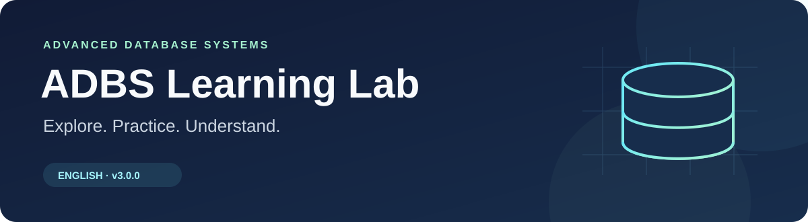
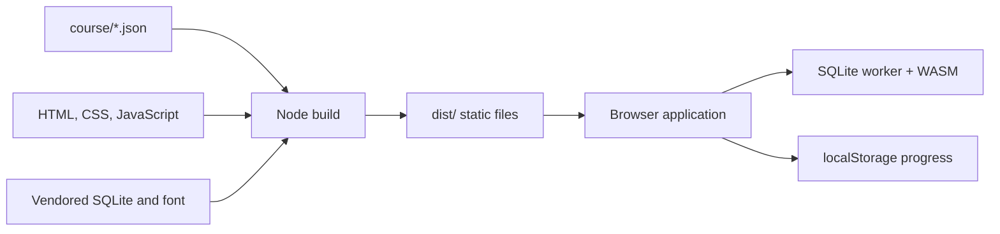

<p align="center">
  
</p>

<p align="center">
  <a href="https://github.com/edward1503/adbs-learning-lab/actions/workflows/ci.yml"></a>
  &nbsp;
  <a href="https://adbs-learning-lab.bot-keep.xyz/"><strong>Live demo ↗</strong></a>
  &nbsp; · &nbsp; English v3.0.0
</p>

An independent English companion to the **University of Edinburgh's Advanced Database Systems course**. Explore source-grounded lessons, practice topic quizzes, and turn database concepts into concrete experiments.

| Lessons | Topics | Practice questions | Key takeaways | Interactive labs | SQL exercises |
| :---: | :---: | :---: | :---: | :---: | :---: |
| **27** | **217** | **1,100** | **56** | **10** | **15** |

## Features

- **Read with context.** Lessons combine learning objectives, worked examples, self-checks, and links to physical pages in the official lecture PDFs.
- **Practice by topic.** Quizzes give explanations and source references, with explicit retries, topic resets, and browser-local answer history. Quiz scores do not automatically mark a lecture complete.
- **Review key takeaways** beside the relevant explanation.
- **Run real SQL.** SQLite runs in a Web Worker through vendored sql.js and WebAssembly, with clean-seed grading for 15 exercises.
- **Explore algorithms.** Labs cover relational operations, buffer replacement, slotted pages, indexes, sorting, join costs, conflict graphs, recovery, quorums, and two-phase commit.
- **Navigate your way.** Browse lessons, search course text and the glossary, and track completed lectures in the English interface.

| Course sequence | Main themes |
| --- | --- |
| Lectures 1–9 | DBMS foundations, SQL, relational algebra, hardware, buffer/storage management, compression, files, tree indexes |
| Lectures 10–18 | Hash indexes, sorting, joins, query evaluation, access paths, cost estimation, plan search |
| Lectures 19–27 | Transactions, locking, recovery, distributed transactions, conjunctive queries, parallel processing, NoSQL |

The companion covers all 27 scheduled Spring 2026 lectures; it does not reproduce every slide sentence or image. Restricted Learn worksheets are excluded. Administrative details in the source slides describe that course edition and should not be treated as current deadlines.

## Architecture



The production application is static HTML, CSS, and JavaScript. Node.js builds and tests it; a static host serves the output. The included Node server is available for local use. There are **no npm runtime dependencies**, accounts, API keys, analytics services, or application data backends required by the app.

## Quick start

Use **Node.js 18 or later** and npm. CI verifies Node.js 24 on Linux and Windows.

```sh
git clone https://github.com/edward1503/adbs-learning-lab.git
cd adbs-learning-lab
npm ci
npm run build
npm test
npm start
```

Open **[localhost:8080](http://localhost:8080)**. The server listens on `0.0.0.0` and reads `SERVER_PORT`, then `PORT`, before falling back to 8080. Serve the app over HTTP so workers and WebAssembly assets can load.

Edit `course/lectureNN.json` or `course/quizNN.json`, then rebuild. `course-data.js`, `quiz-data.js`, and the coverage manifests are generated; keep the JSON modules as the editing source.

## Tests and CI

`npm test` includes 48 application tests covering content/translation contracts, stable routes and IDs, quiz behavior, progress persistence, rendering hooks, lab algorithms, actual SQLite execution, worker lifecycle, and HTTP asset serving, plus deployment safety and diagnostic checks. Test discovery is independent of shell globbing, so the same command works on Windows and Linux.

GitHub Actions checks every pull request and push to `main`, running `npm ci`, `npm run build`, and `npm test` on Linux and Windows. Successful builds upload `dist` with a `release.json` file identifying the app version, source commit, workflow run, and artifact file hashes.

The check job has `contents: read`. Only the separate publication job has `contents: write`; it runs after successful checks on `main` and uses GitHub's temporary repository token. Pull requests cannot publish the deployment branch.

The optional `tests/browser.cjs` and `tests/sql-browser.cjs` suites require Playwright and Chromium separately. They are not part of `npm test`. DOM and Node tests do not establish visual correctness; see [VALIDATION.md](VALIDATION.md) for the checked scope.

## Deployment

The live host is **[adbs-learning-lab.bot-keep.xyz](https://adbs-learning-lab.bot-keep.xyz/)**. Production output is **`dist/`**. The `deploy` branch contains only that output, with `index.html` at its root, so Botkeep can serve it without a remote build step. Deployment commits preserve the branch's history and record the corresponding `main` source commit.

After both platform checks and branch publication pass on `main`, CI saves a verified rollback artifact and imports the checked `deploy` commit through Botkeep's API using the repository's `BOTKEEP_API_KEY` Actions Secret. It uses merge mode, restarts the existing static workload, waits for confirmed completion, and verifies the live source commit and every asset hash. Pull requests cannot run hosting deployment or access that secret. See [the deployment guide](docs/deployment.md) for configuration, failure handling, and rollback.

## Browser-local data

Study state in `localStorage` belongs to one browser profile and site origin. It is not a cloud backup and does not automatically sync between browsers or devices. Clearing site data, switching origins, or using a temporary browsing profile can remove or isolate progress. Storage restrictions may prevent it from persisting.

Lecture state uses `adbs-learning-v2`; topic answers use `adbs-topic-quiz-v1`. Stable lesson, topic, and question IDs preserve existing progress on the same origin and browser. Older five-lesson v1 progress is retained separately and does not automatically become completed full lectures.

SQL data lives in the tab/worker and can be discarded by a reset or reload. Results show at most 200 rows; a query running for more than three seconds terminates the worker and rebuilds the sandbox. Finite-dataset grading does not prove query equivalence on all databases.

The index lab is not a complete B+ tree split implementation, and the recovery lab is not full ARIES. SQLite does not implement `EXCEPT ALL` or `INTERSECT ALL`; the Relational Lab simulates their bag semantics separately. PostgreSQL syntax and physical plans may differ. Use the supplied teaching data rather than private data.

## Attribution and license boundaries

This project is **not endorsed by the University of Edinburgh**. Course explanations and exercises are independently authored companion material grounded in the linked sources. Official PDFs and slide scans are linked rather than bundled or rehosted. [SOURCES.md](SOURCES.md) records teaching sources; [coverage-manifest.json](coverage-manifest.json) records the supplied coverage maps. Physical PDF pages and printed slide numbers are distinguished where relevant.

**No project-wide open-source license has been assigned.** Public availability is not blanket permission to reuse the application or course content. The university and other source authors retain rights to their materials. Third-party components retain their own licenses, which are preserved in [THIRD_PARTY_NOTICES.md](THIRD_PARTY_NOTICES.md) and `vendor/`. Any future project license must distinguish application code, learning content, and third-party components.
