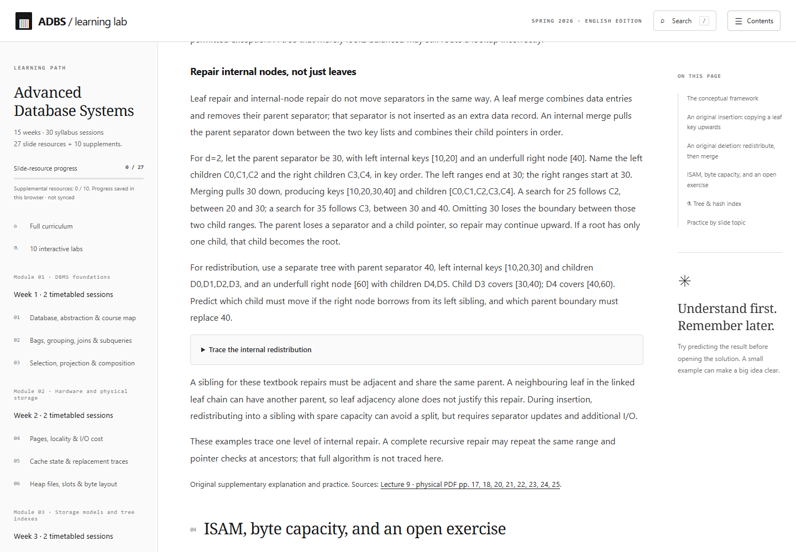
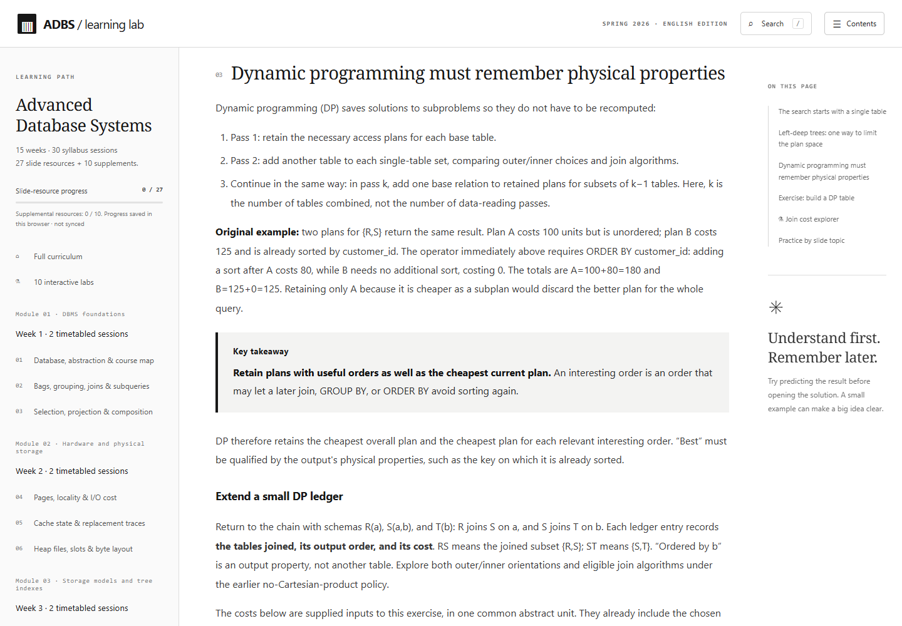
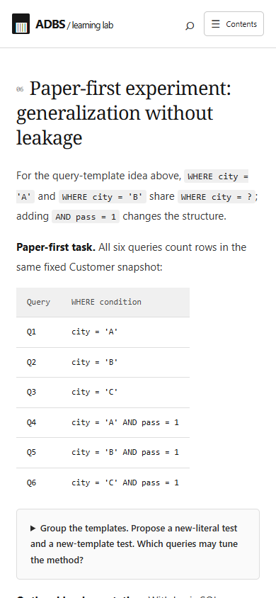
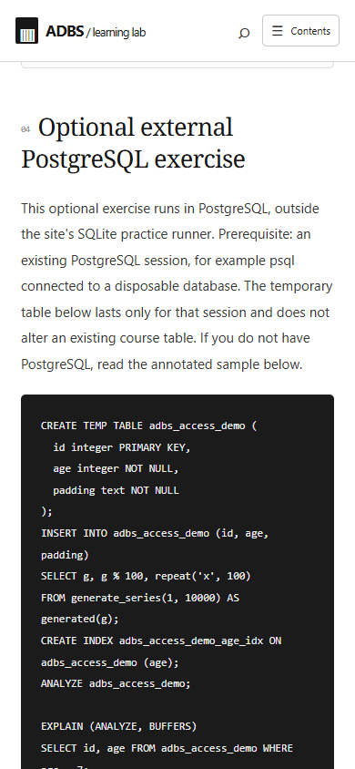

# Local candidate validation

Candidate branch: `readability/learner-review-2026-10`. Baseline: `0a1fb0363d2c44a0ca8f508f4e964a01af128720`. The handoff records the final local commit. This candidate is not pushed, merged or deployed; the existing host and production branches remain unchanged pending parent review.

| Check | Result and practical scope |
|---|---|
| Clean setup | `npm ci` succeeds. Dependencies and lockfile are unchanged. |
| Production build | `npm run build` succeeds; output is `dist/`, containing the static application and vendored SQLite assets. |
| Complete test suite | `npm test`: **113 passed, 0 failed**. Includes existing application/content/lab/SQL checks plus two expanded readability-preservation contracts. |
| Original content protection | All 37 packets retain immutable metadata, full embedded/bank quiz objects and answer meanings, timetable/lab assignments, resource and section identities/order, original subsection anchors, exact ordered Key takeaways and every original section's external citation. The baseline supplemental packet SHA remains recorded, with a separate candidate hash. |
| Actual rendered review | Chromium text captured for all **37 resources / 181 sections**, with disclosure answers expanded. Three independent readers rotate scopes and record tasks for all **120 goals**. These counts establish scope, not comprehension. |
| Browser layout/routes | **74 route checks**: every resource at 1440×1000 and 390×844. Exact section IDs match; no whole-page horizontal overflow, empty headings, broken images or JavaScript page errors. Tables and code may use their intended internal scrolling/wrapping. |
| Browser behavior | Core and supplemental completion survive reload separately. Actual vendored Worker/WASM SQL returns 6 seeded students; solution grading passes against the clean sample. Zero JavaScript page errors. |
| Shown SQL examples | All six complete L2 statements run against their declared fixture in vendored SQLite. The added NULL variant keeps Chi with NOT EXISTS and no rows with NOT IN. The complete L14 correlated EXISTS statement runs with two qualifying orders for one customer and retains that customer once. |
| Optional PostgreSQL | TEMP fixture/index/ANALYZE/EXPLAIN syntax reviewed against linked official documentation. **No PostgreSQL execution or measured plan switch is claimed.** Annotated output is explicitly illustrative. |
| Publication audit | Candidate files contain application prose, preservation checks, source provenance and review evidence. No original PDFs, credentials, unrelated workspace files or private deployment notes are included. Runtime/UI/styles, dependencies, quiz bundle and workflow are unchanged. No new license is assigned. |

[Machine-readable results and file hashes](validation.json) distinguish the original and candidate supplemental packet identities. Canonical text hashes use the repository's LF normalization (`.gitattributes`), so they identify committed bytes even on a Windows checkout. Historical v3.1.0 audit records retain their original accepted SHAs; the [location overlay](current-locations.md) maps moved teaching blocks.

Initial local preview reuse of the test server's port caused a port collision; a separate preview port resolved it. The complete suite passed after the loopback checks ran in the host environment. Neither event required an application change. A missing favicon request was present in the initial browser log; no JavaScript page error occurred.

The repeated section title in rendered-text capture files is metadata followed by the actual DOM heading. It is not a second visible UI heading; a baseline reader's duplicate-heading observation was a capture artifact. The final browser checks and genuine screenshots verify the visible surface.

## Genuine screenshots

These images show the local built candidate. They are browser captures, not illustrations or mockups; they are not evidence that real learners understood the content.

Parent review of actual candidate prose and evidence remains the promotion gate. No GitHub candidate CI run or CD deployment was started. Real learner comprehension, independent-study duration and external PostgreSQL performance remain unmeasured.
